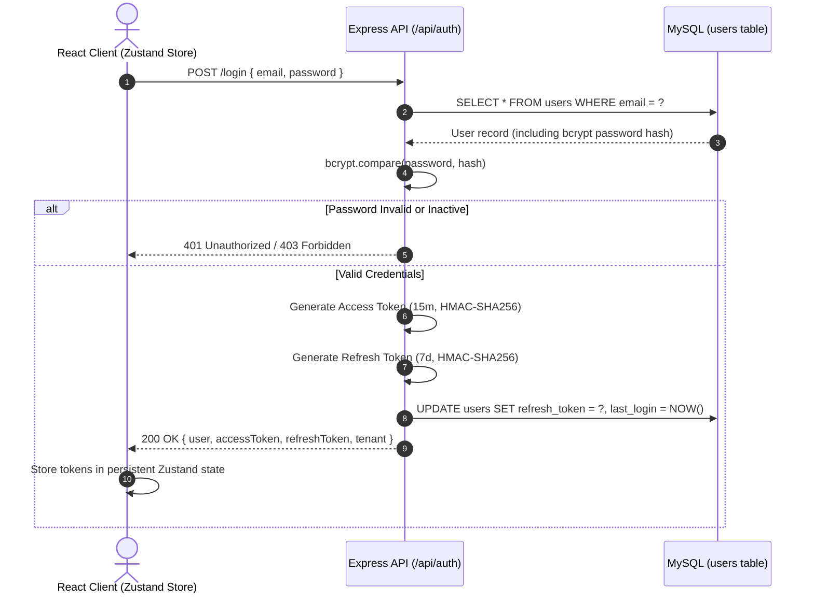

# Technical Requirements Document (TRD)
**Document Version:** 1.0.0  
**Last Updated:** November 19, 2026, 20:32:02 IST (+05:30)  
**Project:** NCLC Platform (AI-Native Multi-Tenant Architecture)  
**Classification:** Technical / Engineering Internal  

---

## 1. Document Control & Metadata
- **Project Name:** NCLC Platform
- **Document Title:** Technical Requirements & Systems Architecture Document (TRD)
- **Author:** Principal Software Architect & DevOps Lead
- **Date & Time of Updation:** 2026-11-19 20:32:02 IST
- **Target Audience:** Full-Stack Engineers, Database Administrators, Security Auditors, DevOps

---

## 2. Technology Stack & Runtime Topology

```
┌────────────────────────────────────────────────────────────────────────┐
│                        CLIENT LAYER (BROWSER)                         │
│  React 18.3.1 + Vite 8.3.8 + TailwindCSS 4.3 + Zustand 5.1 + Axios 1.2  │
│  Port: 5173 | Single-Page Application (SPA) with Client Routing       │
└───────────────────────────────────┬────────────────────────────────────┘
                                    │ HTTP / REST / JSON
                                    │ Authorization: Bearer <JWT>
                                    ▼
┌────────────────────────────────────────────────────────────────────────┐
│                        API GATEWAY / APPLICATION                       │
│  Node.js v25.8.2 + Express.js 4.21.2 + Helmet 8.0 + CORS               │
│  Port: 5000 | Stateless RESTful Microservice                           │
├────────────────────────────────────────────────────────────────────────┤
│  Middleware Pipeline:                                                  │
│   1. Helmet Security Headers                                           │
│   2. CORS Allowed Origin Check (http://localhost:5173)                 │
│   3. JSON Body Parser (10MB payload threshold)                         │
│   4. auth.js (JWT Bearer Token Signature & Expiry Validator)           │
│   5. tenant.js (Tenant Scoping & Multi-Tenancy Boundary Enforcer)      │
│   6. rbac.js (Role Authorization Barrier: SA/FA/MGR/USR)               │
└───────────────────────────────────┬────────────────────────────────────┘
                                    │ Connection Pool (10 max, utf8mb4)
                                    │ Sequelize ORM 6.37.5 + mysql2 3.12
                                    ▼
┌────────────────────────────────────────────────────────────────────────┐
│                        PERSISTENCE LAYER (DATABASE)                    │
│  MySQL Server 26.10 / InnoDB Storage Engine                            │
│  Host: localhost:3306 | Schema: nclc_crm                               │
│  Collation: utf8mb4_unicode_ci | Foreign Key Referential Integrity     │
└────────────────────────────────────────────────────────────────────────┘
```

---

## 3. Architectural Specifications

### 3.1 Multi-Tenancy Pattern: Shared Database, Shared Schema
NCLC utilizes the **Discriminator Column Multi-Tenancy Architecture**. 
- A persistent `tenant_id` column exists on all tenant-bound tables (`users`, `tenant_settings`).
- All queries executed by non-Super-Admin roles are intercepted and injected with `WHERE tenant_id = req.user.tenant_id`.
- Foreign key constraints use cascading or nullifying referential integrity rules to prevent orphan records.

### 3.2 Authentication & Token Lifecycles


### 3.3 Authorization Matrix (RBAC)

| Resource Endpoint | Method | `super_admin` | `firm_admin` | `manager` | `team_user` |
|---|---|---|---|---|---|
| `/api/auth/login` | POST | Public | Public | Public | Public |
| `/api/auth/me` | GET | Authenticated | Authenticated | Authenticated | Authenticated |
| `/api/tenants` | GET, POST | Allow | Deny (403) | Deny (403) | Deny (403) |
| `/api/tenants/:id` | GET, PUT | Allow | Own Firm Only | Deny (403) | Deny (403) |
| `/api/tenants/:id/settings` | GET, PUT | Allow | Own Firm Only | Deny (403) | Deny (403) |
| `/api/users` | GET | All Firms | Own Firm | Own Firm (Team) | Deny (403) |
| `/api/users` | POST | Any Firm | Own Firm | Deny (403) | Deny (403) |
| `/api/users/:id` | DELETE | Any User | Own Firm User | Deny (403) | Deny (403) |
| `/api/users/profile` | PUT | Own Profile | Own Profile | Own Profile | Own Profile |
| `/api/countries` | GET | Authenticated | Authenticated | Authenticated | Authenticated |
| `/api/currencies` | GET | Authenticated | Authenticated | Authenticated | Authenticated |

---

## 4. Hardware, Network & Environment Requirements

### 4.1 Development Hardware Baseline
- **Processor:** 4 Cores or higher (x86_64 or ARM64)
- **RAM:** Minimum 8 GB (16 GB recommended for concurrent Node + MySQL instances)
- **Storage:** 10 GB free disk space (NVMe SSD preferred)

### 4.2 Network & Ports Allocation
- **3306/TCP:** MySQL Database daemon
- **5000/TCP:** Express.js API Gateway
- **5173/TCP:** Vite React Development Server

---

## 5. Security & Cryptography Standards
1. **Password Hashing:** `bcryptjs` with salt round `12` ensuring computational resistance to rainbow tables.
2. **Access Token Secret:** 256-bit entropy pseudo-random alphanumeric string.
3. **Payload Sanitization:** Express body limit capped at `10mb` with JSON syntax exception handling.
4. **CORS Policy:** Strict origin whitelisting (`http://localhost:5173`) with `credentials: true`.
5. **Security Headers:** Enforced via `helmet` (HSTS, Content-Security-Policy, X-Frame-Options: DENY, X-Content-Type-Options: nosniff).
