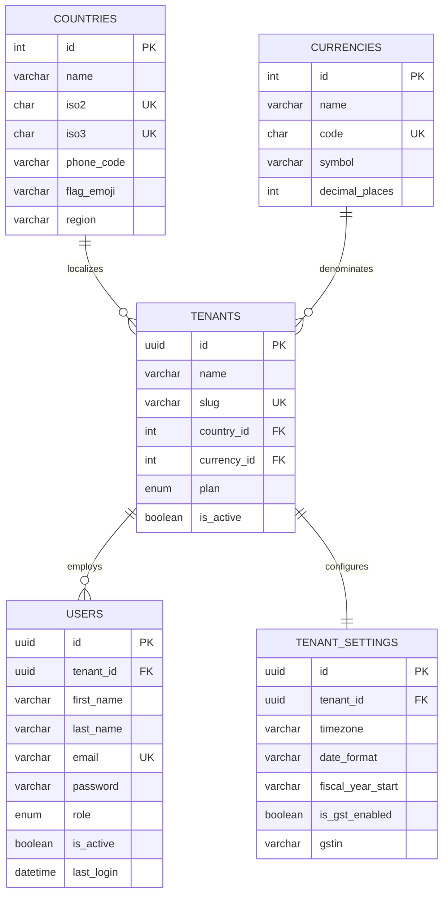

# Technical & Business Logic Documentation (TD)
**Document Version:** 1.0.0  
**Last Updated:** November 19, 2026, 20:32:02 IST (+05:30)  
**Project:** NCLC Platform (AI-Native Multi-Tenant Architecture)  
**Classification:** Core Engineering / Internal  

---

## 1. Document Control & Metadata
- **Project Name:** NCLC Business Platform
- **Document Title:** Technical Functional & Business Logic Document (TD)
- **Author:** System Architecture & Core Engineering Team
- **Date & Time of Updation:** 2026-11-19 20:32:02 IST
- **Target Audience:** Backend Developers, Frontend Developers, Code Reviewers, Systems Integrators

---

## 2. Core Business Logic Algorithms

### 2.1 Multi-Tenant Isolation Algorithm
The cornerstone of NCLC's business security is the logical data barrier between organizations. Every request traversing through the middleware stack undergoes the following procedural verification:

```
                  ┌────────────────────────────────────────┐
                  │          Incoming HTTP Request         │
                  └───────────────────┬────────────────────┘
                                      │
                                      ▼
                  ┌────────────────────────────────────────┐
                  │       auth.js: Extract Bearer Token    │
                  └───────────────────┬────────────────────┘
                                      │
                     Is token valid & unexpired?
                     ├── NO ──► 401 Unauthorized
                     └── YES ──► Attach req.user = { id, email, role, tenant_id }
                                      │
                                      ▼
                  ┌────────────────────────────────────────┐
                  │      tenant.js: Tenant Scoping Guard   │
                  └───────────────────┬────────────────────┘
                                      │
                      Is user.role === 'super_admin'?
                      ├── YES ──► Bypass tenant filter (can pass any ?tenant_id)
                      └── NO  ──► Check user.tenant_id
                                       │
                         Does user have a valid tenant_id?
                         ├── NO  ──► 403 Forbidden ("No tenant association")
                         └── YES ──► Force req.tenantId = user.tenant_id
                                       │
                                       ▼
                  ┌────────────────────────────────────────┐
                  │         ORM Query Execution            │
                  │   Sequelize enforces:                  │
                  │   where: { ...query, tenant_id }       │
                  └────────────────────────────────────────┘
```

### 2.2 Slug Generation & URL Normalization
When creating or editing a firm tenant, the system normalizes human-entered names into URL-safe strings:
```javascript
// Business Logic Rule:
// 1. Lowercase entire string
// 2. Replace whitespace runs with single hyphen '-'
// 3. Strip all characters except lowercase alphanumeric and hyphens
const slug = name.toLowerCase().trim()
  .replace(/\s+/g, '-')
  .replace(/[^a-z0-9-]/g, '');
```

### 2.3 Password Validation & Hashing Procedure
```javascript
// 1. User submits plaintext password
// 2. Minimum length rule: >= 6 characters
// 3. Salt generation using bcrypt with 12 rounds
const hashedPassword = await bcrypt.hash(rawPassword, 12);
// 4. Verification during login
const isValid = await bcrypt.compare(candidatePassword, user.password);
```

---

## 3. Middleware Architecture & Execution Pipelines

### 3.1 `auth.js` Middleware
- **Header Inspected:** `Authorization: Bearer <JWT_STRING>`
- **Logic:**
  1. Validates that the header exists and starts with `Bearer `.
  2. Verifies signature against `JWT_ACCESS_SECRET`.
  3. Checks expiry timestamp (`exp`).
  4. Decodes payload into `req.user`.

### 3.2 `tenant.js` Middleware
- **Responsibility:** Injects the active `req.tenantId` context.
- **Rule:** If the user is a `super_admin`, they may optionally pass a `tenant_id` query/body parameter to operate on behalf of a specific firm. All other roles have their `req.tenantId` rigidly locked to their authenticated database record.

### 3.3 `rbac.js` (Role-Based Access Control)
- **Signature:** `requireRole(...allowedRoles)`
- **Evaluation:**
  ```javascript
  const requireRole = (...roles) => {
    return (req, res, next) => {
      if (!req.user || !roles.includes(req.user.role)) {
        return res.status(403).json({
          success: false,
          message: 'Access denied: insufficient permissions'
        });
      }
      next();
    };
  };
  ```

---

## 4. Entity Relationship Logic & Foreign Key Cascades



### 4.1 Cascade Rules
1. `TENANTS` → `TENANT_SETTINGS`: `ON DELETE CASCADE` — Deleting a firm completely purges its settings.
2. `TENANTS` → `USERS`: `ON DELETE SET NULL` — User records are safeguarded from hard deletion; firm deactivation or suspension is preferred.
3. `COUNTRIES` → `TENANTS`: `ON DELETE SET NULL`.
4. `CURRENCIES` → `TENANTS`: `ON DELETE SET NULL`.

---

## 5. Frontend State Management & Persistence (Zustand)

### 5.1 Storage Architecture
The client application uses `zustand` paired with the `persist` middleware to cache authenticated sessions inside browser `localStorage` (`key: 'nclc-auth'`).

### 5.2 State Lifecycle
1. **On Login:** `setAuth({ user, accessToken, refreshToken, tenant })` writes session data to memory and disk.
2. **On Request:** Axios interceptor extracts `accessToken` and sets `headers.Authorization = 'Bearer ' + token`.
3. **On Logout:** `logout()` purges tokens and user state, immediately rerouting to `/login`.
4. **On Role Redirect:** Route guard checks `user.role` against navigation permissions.
